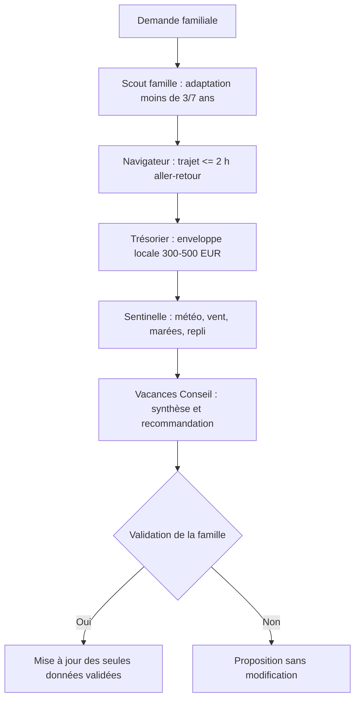

# 🏕️ HolidayOS • Système Agentique de Planification de Vacances (Template Open-Source)

> **Séjour en étoile depuis un hébergement fixe à Cancale, du 25 octobre au 1er novembre 2026.**  
> *Deux adultes, deux enfants de 7 et 2 ans (le plus jeune ayant moins de 3 ans pendant le séjour); enveloppe sur place de 300 à 500 EUR et sorties limitées à 2 h de conduite aller-retour.*

Site : [Dashboard Cancale](https://rbatos.github.io/vacances-agent-system-cancale/dashboard.html)

---

## 🌟 Présentation du Système

HolidayOS utilise les agents et skills GitHub Copilot définis dans `.github/` pour rechercher des idées de sorties, vérifier leur faisabilité avec de jeunes enfants et préparer des arbitrages soumis à la famille.

Pour reprendre la démarche de transformation depuis le dépôt d'origine, consulter la [procédure de transformation](PROCEDURE_TRANSFORMATION_PROJET.md).
Pour préparer le séjour avec les agents, suivre la [procédure d'utilisation des agents](PROCEDURE_UTILISATION_AGENTS.md).



---

## Agents Copilot

Les agents sont définis directement dans [`.github/agents/`](.github/agents/) et leurs règles de séjour dans [`.github/instructions/vacances-charter.instructions.md`](.github/instructions/vacances-charter.instructions.md). Ils conseillent; la famille garde la décision.

- **vacances-conseil** orchestre la demande, délègue les analyses pertinentes et présente une recommandation.
- **vacances-scout-famille** vérifie l'adaptation aux enfants de moins de 3 ans et de 7 ans, la marche, l'accès poussette, les pauses et la possibilité d'écourter.
- **vacances-logistique** vérifie les temps aller-retour cumulés depuis Cancale, avec un maximum de 2 h.
- **vacances-tresorier** compare les coûts famille à l'enveloppe locale de 300 à 500 EUR.
- **vacances-sentinelle-meteo** vérifie météo, vent, marées et solutions de repli d'automne.

---

### Utilisation avec GitHub Copilot

Les skills ci-dessous sont disponibles dans le chat Copilot sous forme de commandes `/` :

- `/vacances-nouvelle-etape` : évaluer une activité ou une étape proposée.
- `/vacances-plan-b` : préparer une bascule en cas d'aléa.
- `/vacances-budget` : analyser une dépense, une réservation ou le budget global.
- `/vacances-checklist-depart` : préparer ou vérifier les éléments de départ.

Ils se trouvent dans [`.github/skills/`](.github/skills/) et s'appuient sur [`.github/copilot-instructions.md`](.github/copilot-instructions.md) et la [charte Copilot](.github/instructions/vacances-charter.instructions.md).

#### Sous-agents spécialisés

Sélectionner **vacances-conseil** dans le sélecteur d'agents pour coordonner une demande. Cet orchestrateur peut déléguer les analyses aux sous-agents Scout famille, Navigateur logistique, Trésorier et Sentinelle météo, définis dans [`.github/agents/`](.github/agents/). Chaque profil contient directement ses responsabilités et contraintes; les spécialistes sont en lecture seule et rendent un avis à l'orchestrateur. La charte autonome est dans [`.github/instructions/vacances-charter.instructions.md`](.github/instructions/vacances-charter.instructions.md).

---

## Générateurs Cancale

- `sync_system.py` lit `vacances_data.json` et produit `carte_cancale.html` ainsi que `carnet_cancale.html`.
- `sync_system.py` produit aussi `dashboard.html`, un tableau de bord responsive basé sur les mêmes données.
- `generate_map.py`, `generate_print.py` et `generate_dashboard.py` permettent de produire séparément ces livrables.
- `generate_map.py` utilise Folium (`py -m pip install folium`) et géocode les destinations publiques via Nominatim pour placer les marqueurs. Les îles et certains lieux événementiels utilisent des repères cartographiques approximatifs documentés dans le code, car ils ne confirment ni terminal, ni accès autorisé. La première génération nécessite Internet; les coordonnées géocodées sont mises en cache dans `geocode_cache.local.json` (ignoré par Git).
- `carte_cancale.html` utilise les tuiles Esri World Street Map avec attribution Esri et OpenStreetMap, pour éviter les blocages des tuiles standard OpenStreetMap et l'exigence de clé des tuiles CARTO. Le fond cartographique nécessite une connexion Internet.
- `dashboard.html` embarque les données de génération, s'ouvre directement dans un navigateur et affiche les sorties et options à confirmer. Ses onglets « Rennes & Route du Rhum » et « Guernesey, Jersey & Chausey » présentent des propositions détaillées, les réserves de transport, météo, tarifs et conditions à vérifier. Les îles figurent dans `vacances_data.json` comme options non validées afin d'alimenter les vues budget, carte et checklist; aucun montant ni aucune réservation n'est confirmé. La carte affichée dans le dashboard est `carte_cancale.html`.

---

## 🔒 Confidentialité & Sécurité OpSec

Ne pas inscrire de nom, adresse privée ou référence de réservation dans les fichiers partagés. Les fichiers `*.local.json` restent ignorés par `.gitignore` pour les données locales.

---

## 🚀 Utilisation Rapide

Sélectionner `vacances-conseil` dans le sélecteur d'agents Copilot, ou invoquer un skill `/vacances-*` dans le chat. Exécuter `py sync_system.py` après la mise à jour des données pour régénérer la carte, le carnet Cancale et le dashboard.

---

## 📂 Structure du Répertoire

```text
├── .github/
│   ├── copilot-instructions.md         # Consignes globales GitHub Copilot
│   ├── instructions/
│   │   └── vacances-charter.instructions.md
│   ├── agents/
│   │   ├── vacances-conseil.agent.md   # Orchestrateur et délégation aux spécialistes
│   │   ├── vacances-scout-famille.agent.md
│   │   ├── vacances-logistique.agent.md
│   │   ├── vacances-tresorier.agent.md
│   │   └── vacances-sentinelle-meteo.agent.md
│   └── skills/
│       ├── vacances-nouvelle-etape/SKILL.md
│       ├── vacances-plan-b/SKILL.md
│       ├── vacances-budget/SKILL.md
│       └── vacances-checklist-depart/SKILL.md
├── vacances_data.json                  # Source de vérité structurée unique
├── sync_system.py                      # Génère la carte, le carnet et le dashboard
├── generate_map.py                     # Carte Folium depuis les étapes
├── generate_print.py                   # Carnet imprimable depuis les données JSON
└── generate_dashboard.py               # Dashboard HTML depuis les données JSON
```
